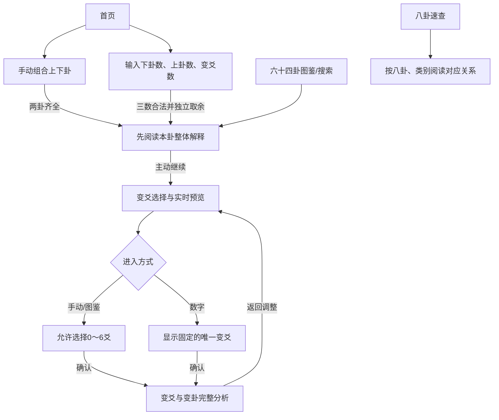

# 易经学习微信小程序 PRD v1.3

| 项目 | 内容 |
| --- | --- |
| 文档版本 | v1.3 |
| 编制日期 | 2026-10-21 |
| 最近更新 | 2026-10-22：同步查询、简洁速查与实际数据结构 |
| 产品定位 | 面向《易经》初学者的课堂辅助学习与查询工具 |
| 实施策略 | 方案 A：功能优先、逐步完善 |
| 目标平台 | 微信原生小程序，iOS / Android 微信 |
| 首版交付 | 功能与资料完整、通过真机验收、可邀请同学使用的微信体验版 |
| 需求依据 | [《生成易经小程序方案》完整需求访谈](https://chatgpt.com/c/6ad862f5-64e8-83e8-9ca6-b1ce7f1d20d2)，共 21 项确认；含原会话上传的课堂“取象比类”表 |
| 使用对象 | 产品负责人、Codex 开发者、古籍内容校对者、测试者 |

本文保留产品规则与完整版本验收标准；基础原型已关闭，查询与简洁速查已实现。当前交付和下一阶段统一见[开发计划](development-plan.md)，实际结果见[验证记录](validation.md)，采用版本和待审项见[资料核对](content-review.md)。功能完成不代表文献审核或体验版发布通过。

2026-10-22首版验收调整：用户取消文献人工复审和真机性能计时要求。首版保留完整性、引用/哈希、电子初核、核心功能和包体检查；影印、独立复审及释义人工审查的待审状态继续留档。下文涉及这两项的早期目标不再作为首版必过门槛。

## 1. 产品目标与范围

### 1.1 解决的问题

初学者需要把“两个三爻卦如何构成六爻卦”“某一爻变化后得到什么卦”“原文与意象如何理解”联系起来。本产品提供从组合、识卦、阅读到变爻分析的连续流程，同时支持直接检索与课堂速查。

产品目标：

1. 用户可以通过拖拽或点击选择上下卦，实时获得组合卦名；也可以输入三个正整数生成数字卦。
2. 用户先理解本卦整体含义，再查看变爻及变卦，形成从整体到局部的学习顺序。
3. 六十四卦资料与八卦对应关系可离线查询，原文、意象、整体含义与资料来源清楚对应。
4. 项目结构适合练习微信原生开发，计算、数据与界面分离，便于 Codex 分阶段实现。

### 1.2 首版边界

| 纳入 v1.0 | 不纳入 v1.0 |
| --- | --- |
| 手动上下卦组合、数字卦生成 | 摇卦、铜钱、蓍草、时间起卦等其他生成方法 |
| 本卦整体解析、0～6 条手动变爻、单条数字变爻 | 主爻判定、自动吉凶判断、传统占断引擎 |
| 变卦完整解析、爻辞与小象传 | 本卦与变卦对应爻辞的逐爻对照功能 |
| 六十四卦多维检索、八卦意象速查 | 8×8 矩阵检索界面、详细万物类象搜索词典 |
| 公开古籍原文、意象、整体含义、来源与校验 | 多版本异文对照阅读器、《文言》等扩展经典全文 |
| 本地打包资料、真机适配、体验版交付 | 登录、服务器、云数据库、云同步、历史、收藏、社交、支付 |

学习展示保留原典本身的“吉”“凶”等文字，但系统不据此生成用户个人运势、决策或吉凶结论。用九、用六作为特殊知识展示，不参与主爻选择。

### 1.3 完成标准

- 8×8 共 64 种上下卦组合全部正确；64 卦 × 64 种变爻集合共 4096 种计算全部通过测试，包含零变爻。
- 64 卦的卦辞、彖传、大象传，384 条常规爻辞及小象传，以及用九、用六相关条文完整，原文逐条核对、展示释义逐条审查、来源可追溯。
- 两条生成流程、图鉴检索、八卦速查在 iOS、Android 真机可用；资料随包安装后断网仍可访问。
- 已上传体验版，具备体验权限的同学可在手机微信完成核心流程。模拟器或开发预览二维码不替代该验收。

## 2. 已确认的 21 项需求

需求编号沿用访谈轮次，后续开发任务与测试引用该编号。

| 编号 | 已确认需求 | 实施位置 | 核心验收 |
| --- | --- | --- | --- |
| R01 | 首页提供手动八卦组合、数字卦生成两个入口；组合实时显示卦名 | 首页、组合页、数字页 | 两种方式均进入统一本卦详情 |
| R02 | 先天数为乾1、兑2、离3、震4、巽5、坎6、艮7、坤8；余0按8或6 | 计算层 | 三个数分别决定下卦、上卦、变爻 |
| R03 | 先读本卦整体解释，再进入变爻环节；手动允许多个变爻，数字固定一个 | 本卦详情、变爻页 | 数字模式也不得直接跳过本卦阅读 |
| R04 | 本卦采用辅助学习型内容：卦名、卦形、构成、卦辞、彖传、象传原文、意象、整体含义 | 本卦详情 | 原文完整，意象与整体含义可折叠 |
| R05 | 多变爻采用学习展示模式，展示全部所选爻并计算变卦，不判断主爻或吉凶 | 分析页、计算层 | 手动可选0～6爻，所有选中爻均显示 |
| R06 | 八卦意象以课堂表为基础，补充常用重要意象 | 八卦速查、意象数据 | 展示课堂8类、五行、颜色、生克；先天数/方位仅保留于资料 |
| R07 | 六十四卦展示公开古籍原文，注明出处；白话保留在资料档案中 | 内容层、来源面板 | 原文与意象、整体含义分区展示 |
| R08 | 三个主要模块：首页、六十四卦图鉴及搜索、八卦速查 | 原生底部导航 | 无需生成卦象也能直接查询 |
| R09 | 微信原生技术栈：WXML、WXSS、TypeScript、原生API | 工程结构 | 开发者工具可编译、真机可运行 |
| R10 | 全部本地JSON或TS模块，支持离线，不开发后端 | 数据层、资源打包 | 核心资料不依赖网络和账号 |
| R11 | 首版可邀请同学在手机微信体验，包含真机测试与适配 | 阶段五 | iOS / Android 验收并交付体验版 |
| R12 | 现代简约结合国风，米白、深灰、少量古铜色，减少说明性文字，重易读与简洁 | 全局样式、组件 | 阅读与触控清晰一致 |
| R13 | 分区折叠；卦辞、意象与整体含义默认展开，彖传、大象传默认收起 | 详情、分析页 | 展开状态与内容对应准确 |
| R14 | 点击爻线选择或取消，实时预览变卦，确认后进入分析 | 变爻页 | 手动可切换，数字模式唯一变爻只读 |
| R15 | 分析页包含本卦所选爻与小象原文、变卦经传原文、意象和整体含义 | 分析页 | 复用完整解析组件，不只显示卦名 |
| R16 | 图鉴支持卦名、拼音、别名、序号搜索及上下卦筛选 | 图鉴、搜索模块 | 搜索与筛选可同时生效 |
| R17 | 手动组合同时支持拖拽、点击、一键交换和清空 | 组合页 | 四项操作一致更新卦名及卦形 |
| R18 | 三框允许任意正整数与多位数字，拒绝0、负数、小数 | 数字页、字符串取模 | 超过安全整数范围仍精确计算 |
| R19 | 收录大象、小象与用九、用六；本卦看大象，所选变爻看对应小象原文 | 内容模型、详情、分析 | 特殊条文独立于6个爻位 |
| R20 | 所有原文逐条核对、展示释义逐条审查、保留来源，自动测试全部计算 | 校验流程、测试 | 不以抽检代替全量审查 |
| R21 | 方案A：功能优先、逐步完善，按五阶段推进 | 开发计划 | 每阶段都有可检查交付物与退出条件 |

## 3. 用户与典型场景

| 用户/场景 | 需求 | 完成路径 |
| --- | --- | --- |
| 公选课初学者：老师给出上坎下震 | 快速知道组合卦与含义 | 手动组合 → 水雷屯 → 本卦详情 |
| 初学者：想观察乾卦二、五爻变化 | 同时看到爻辞与结果 | 乾卦详情 → 选二、五爻 → 离为火分析 |
| 数字练习：输入17、26、9 | 生成本卦并查看固定变爻 | 数字输入 → 泽天夬本卦 → 三爻变 → 兑为泽 |
| 课后复习：只记得“qian”或“泰” | 不经过组合直接找到资料 | 六十四卦搜索 → 详情 |
| 课堂速查：查询巽对应身体与方位 | 按类快速查看对应内容 | 八卦速查 → 巽 → 身体/方位分类 |
| 开发学习者 | 理解小程序的页面、组件、纯函数与资料组织 | 按五阶段实现和验收 |

## 4. 信息架构与用户流程

### 4.1 页面与导航

```text
底部原生 TabBar
├── 首页 pages/home/index
│   ├── 手动组合 pages/compose/index
│   └── 数字起卦 pages/numbers/index
├── 六十四卦 pages/atlas/index
│   └── 搜索框 + 上卦筛选 + 下卦筛选 + 64卦列表
└── 八卦速查 pages/trigrams/index
    └── 八卦选择 + 类别筛选 + 对应关系 + 五行生克说明

共用学习页面
├── 本卦详情 pages/hexagram/index
├── 变爻选择与预览 pages/changes/index
└── 变卦分析 pages/analysis/index

共用组件/面板
├── 卦形、爻线、八卦卡片
├── 原文、意象与整体含义折叠、爻辞卡片
└── 来源与版本面板、空状态、错误提示
```

只有三个一级页显示 TabBar；其余使用原生导航栏返回。图鉴进入详情时按手动学习规则进行后续变爻探索。来源面板不是第四个主要模块。

### 4.2 主流程



### 4.3 状态与返回规则

- 流程状态包括来源模式、本卦ID、所选爻位、数字模式的固定爻位；均只保存在当前会话内存。
- 从分析返回选择页，保留选择；从选择返回详情，保留本卦、折叠和滚动状态；返回输入页，保留本次输入或组合。
- 重新生成本卦或改变上下卦后，清除旧变爻和旧分析结果，数字模式按新输入重新计算。
- 新开一次生成流程时创建新状态；图鉴直接查阅不继承此前数字模式的固定变爻。
- 一级页切换可保留本次搜索条件与滚动位置；重启后不恢复历史，不把流程记录写为历史列表。
- 路由参数只传稳定ID、模式及必要的爻位编码，不在URL中传完整古籍、释义或超长输入值。
- 参数缺失、非法ID、数字模式没有合法固定爻位时，显示“无法读取本次结果，请重新生成”，提供返回首页；不得默认为乾卦。

## 5. 详细功能

### 5.1 首页

保留主标题、居中的装饰卦形及“手动组合”“数字起卦”两张入口卡片；移除左上角“易象录 · 学习原型”和入口数字标号。入口文字靠左、在卡片内垂直居中，右上角箭头独立定位。两张入口使用相同底色，仅当前按下的按钮反馈。提示简短，不重复说明流程。

两个入口进入新流程；图鉴与速查由底部导航直达。不要求登录，不弹出无关授权。

### 5.2 手动组合

**内容与布局：**上方依次为“上卦”“下卦”两个放置区，中间显示当前组合卦名与六爻图，底部为8个可复用八卦卡片及交换、清空、查看本卦按钮。

**规则：**

1. 初始上下卦均为空。只选一卦时显示已选信息及“请选择上卦/下卦”，不伪造完整卦名；查看按钮不可用。
2. 八卦卡片是选择源，拖入槽位不会消耗卡片；同一卦可以同时用于上下卦，允许八个纯卦。
3. 拖动时高亮有效放置区；松手落入某槽位即替换该槽位；落在外部或触摸取消则回弹，不改状态。
4. 点击八卦卡片弹出“放入上卦/放入下卦”操作，效果与拖拽一致；取消不改组合。
5. 两卦齐全后实时更新卦名、卦序、上下卦文字与六爻图，禁止根据显示文字反推卦ID。
6. “交换上下卦”交换两个槽位，包括一空一实的情况；均为空时按钮禁用。交换两次恢复原组合。
7. “清空组合”清除两个槽位、待放置选择与旧结果，回到初始状态。
8. 点击“查看本卦”才进入详情；组合页不提前要求选择变爻。

**异常：**拖拽与页面滚动冲突时，仅在有效拖动期间接管手势；不能以关闭整页滚动解决。快速替换、触摸中断及横竖尺寸变化后不得出现视觉卡片与实际状态不一致。

### 5.3 数字起卦

三个单行输入框按阅读顺序标注“①下卦数”“②上卦数”“③变爻数”。不展示取余或三数相加规则。空框显示“请输入正整数”，聚焦时提示颜色变浅，输入后消失；提示与输入共用同一行。

**输入约定：**

- 输入作为十进制字符串处理，允许多位及超过 JavaScript 安全整数范围的正整数，不限定为1～9或某个数值上限。
- 去除首尾空白后，必须只含ASCII数字且至少有一位非零数字；内部空白、正负号、小数点、科学计数法、全角数字、字母均拒绝。
- 接受“00017”并按17处理；“0”“000”均拒绝。不得用 `parseInt` 的部分解析行为把“17abc”当作17。
- 不得静默截断长输入，不使用组件默认的短长度限制。原生输入组件关闭默认长度限制；其具体属性在阶段一按工具支持情况验证。
- 采用数字键盘提示，但键盘不替代校验；需覆盖粘贴、输入法和程序化参数。
- 非法输入在对应框下给出具体错误，保留原始输入以便修改；未完整或有错时不能生成。
- “任意正整数”指不受浮点精度和业务数值上限限制；不承诺有限设备能容纳无限字符。异常大的输入遇到设备资源问题时应明确提示，不取截断后的结果。基准测试至少包含每框1000位输入。

**计算与展示：**

1. 分别计算下卦数mod8、上卦数mod8、变爻数mod6；余数0分别映射到8、8、6。
2. 页面不显示计算过程；生成按钮进入本卦详情，保留唯一变爻但不直接打开分析页。
3. 变爻页自动选中唯一爻，不允许取消、改选或增加；提供“返回修改数字”。
4. 不把三数相加，不加入当前时间、随机数或其他起卦规则。

### 5.4 本卦详情

展示顺序：

| 区域 | 内容 | 初始状态 |
| --- | --- | --- |
| 卦头 | 卦序、卦名/全称、六爻图、上卦与下卦名称、简要含义 | 展开 |
| 卦辞 | 原文，可折叠 | 展开 |
| 卦象意象与整体含义 | 紧接卦辞，可折叠 | 展开 |
| 彖传 | 原文 | 折叠 |
| 大象传 | 原文 | 折叠，标题明确为“大象传” |
| 特殊知识 | 乾的用九、坤的用六及对应象传原文 | 仅乾/坤出现，可折叠 |
| 来源 | 出处、版本、定位、必要署名与许可，可复制固定链接 | 点击打开面板 |
| 下一步 | 手动/图鉴为“选择变爻”；数字为“查看固定变爻” | 可操作 |

经传、爻辞和特殊条文仅展示原文。意象与整体含义保留简短学习内容；不重复展示审核、计算或开发说明。初入页面不弹出变爻选择。

爻辞与小象、用九/用六与相关象传合用来源面板时，应同时展示两段各自的来源定位。

### 5.5 变爻选择与预览

- 同时呈现“本卦（选择区）”与“变卦（预览）”；小屏可上下排列，但始终保留文字区分。
- 爻线视觉由上至下绘制，依次对应爻位6、5、4、3、2、1。标签“初九/初六、九二/六二……上九/上六”取自本卦阴阳。
- 手动/图鉴模式点击某一爻的整行触控区，切换选中状态；本卦爻形保持原样，右侧预览才反转所选爻。
- 用古铜色标记、选中图标和“已选”文字共同表达状态；不单独依赖颜色或细线命中。
- 展示选中数量和爻名，按从初爻到上爻排序；提供“清空变爻”。每次变化实时更新预览卦名和卦形。
- 允许零变爻：提示“未选择变爻，本卦保持不变”，可继续查看同卦整体资料，不生成虚假爻辞。
- 数字模式显示固定1爻、自动预览，爻线只读；清空功能不出现。
- 点击确认后进入独立分析页；预览本身不自动跳转。

### 5.6 变爻与变卦分析

1. 顶部列出本卦、变卦及变化爻位，保留两张卦形以便理解。
2. 按爻位1→6逐条呈现本卦中所有选中爻：本卦爻名、爻辞原文、对应小象传原文与来源。
3. 使用本卦爻辞，不替换为变卦同位置爻辞。所选爻的内容默认可见；长注释可折叠。
4. 变卦部分复用详情内容组件：卦名、卦序、上下卦、经传原文、意象、整体含义与来源。卦辞及意象与整体含义默认展开，彖传与大象传默认折叠。
5. 零变爻显示“本卦未发生变化”，隐藏变爻条目，合并重复的整体内容；仍显示本卦与结果相同的信息。
6. 六爻全变时保留全部6条常规爻的学习展示。乾/坤的特殊知识可附加呈现，但不替代所选爻、不自动判定占断依据。
7. 提供返回调整入口；分析页中的变卦阅读组件不自动开启下一轮递归分析，避免流程与返回栈失控。

### 5.7 六十四卦图鉴与搜索

**列表：**默认按通行《周易》卦序1～64排列。卡片包含卦序、卦名/全称、微型卦形、上卦及下卦。点击直接进入共用本卦详情。

默认不显示收录数量，搜索或筛选生效时显示结果数。

**检索约定：**

- 支持简体卦名、全称、经过校对的繁体名称、别名、无声调拼音全拼、拼音首字母及阿拉伯序号。首字母支持属于本PRD补齐的便利规则。
- 例如“乾”“乾为天”“qian”“QIAN”“qwt”可命中乾；“泰”“地天泰”“11”可命中泰。
- 关键词做首尾去空白、拉丁字母转小写和拼音去声调规范化；全文正文搜索不在首版范围。
- 全数字关键词按卦序精确匹配，“1”不顺带匹配10～19，“01”按1，“65”“0”无结果。普通文字/拼音采用子串匹配，多结果保留卦序排序。
- 上卦与下卦筛选各为“不限+8卦”；多个条件取交集：关键词 AND 上卦 AND 下卦。上、下卦不得交换使用。
- 空关键词且无筛选时显示64卦；上乾下坤应只显示第12卦天地否，上坤下乾应显示第11卦地天泰。
- 输入后延迟150ms刷新，不回写输入或打断组词；筛选立即生效。清除关键词保留筛选，重置恢复全部；返回详情及切换一级页保留本次条件与滚动位置，不持久化历史。
- 无匹配时展示“没有找到符合条件的卦”，保留筛选并提供重置入口，不显示空白页。
- 同名或同拼音可能匹配多卦，不强制替用户自动跳转；别名必须有来源或编辑依据。

### 5.8 八卦意象速查

采用两行8卦卡片选择器与类别筛选，切换类别后查看当前卦对应内容；“全部”显示分组资料，卦性排在所有意象之前。按2026-10-22用户反馈，页面仅展示类别与对应值，不展示来源、体系或解释小字，完全相同的对应值去重；“季节”不带“课堂表”后缀。先天数及先天方位不进入页面和类别选择器，原有资料与来源审核继续留档。

课堂参考表“取象比类”的内容转录如下，数据入库时保留该来源身份。此表是课堂资料记录，不把其全部关系归为《周易》原文：

| 类别 | 乾 | 坤 | 震 | 巽 | 坎 | 离 | 艮 | 兑 |
| --- | --- | --- | --- | --- | --- | --- | --- | --- |
| 自然 | 天 | 地 | 雷 | 风 | 水 | 火 | 山 | 泽 |
| 卦性 | 健 | 顺 | 动 | 入 | 陷 | 丽 | 止 | 悦 |
| 人伦 | 父 | 母 | 长男 | 长女 | 中男 | 中女 | 少男 | 少女 |
| 动物 | 马 | 牛 | 龙 | 鸡 | 豕（猪） | 雉 | 狗 | 羊 |
| 身体 | 首 | 腹 | 足 | 股 | 耳 | 目 | 手 | 口 |
| 后天方位 | 西北 | 西南 | 东 | 东南 | 北 | 南 | 东北 | 西 |
| 八门 | 开门 | 死门 | 伤门 | 杜门 | 休门 | 景门 | 生门 | 惊门 |
| 季节（课堂表） | 秋冬 | 夏秋 | 春 | 春夏 | 冬 | 夏 | 冬春 | 秋 |

扩展资料及页面范围：

| 类别 | 范围与呈现要求 |
| --- | --- |
| 五行 | 乾兑金、震巽木、坎水、离火、坤艮土 |
| 先天卦数 | 乾1、兑2、离3、震4、巽5、坎6、艮7、坤8；仅保留资料，不在速查展示 |
| 先天方位 | 乾南、兑东南、离东、震东北、巽西南、坎西、艮西北、坤北；仅保留资料，不在速查展示 |
| 颜色 | 收录经来源核对的常见类象；允许同一卦有多个、不同体系的颜色条目，不强行归为唯一颜色 |
| 五行生克 | 相生：木→火→土→金→水→木；相克：木→土→水→火→金→木；按当前卦五行显示相关关系，以“相生”“相克”两栏配箭头呈现 |
| 基本解释 | 对“健、顺、入、丽”等的整理释义保存在资料档案，速查页面不显示 |

“八门”的奇门遁甲体系归属在资料中登记；季节保留课堂表用词，若另增文献用词则另建条目。经典中的“兑，说也”与课堂“悦”保留原字及解释对应，不擅自改写原典。正文来源可参考[《说卦》](https://zh.wikisource.org/zh-hant/周易/說卦)，先天数等后世象数资料可参考[《梅花易数》](https://zh.wikisource.org/zh/梅花易數)，具体版本与条目须按第9节核对后入库。

首版做类别筛选；跨全部意象的关键词词典搜索留待后续。

## 6. 微信原生技术方案

### 6.1 技术栈与约束

| 层 | 选型 | 实施要求 |
| --- | --- | --- |
| 页面 | WXML + WXSS + 原生Page | 不引入Vue、React、Taro、uni-app或WebView承载主界面 |
| 逻辑 | TypeScript，开启strict | 纯计算函数不得引用wx、页面实例或DOM |
| 组件 | 原生Component | 卦形、折叠内容等由props驱动，事件返回稳定ID/爻位 |
| 数据 | 本地JSON源文件 + 构建生成的TS模块/索引 | 数据随包发布，运行期不请求远端内容 |
| 开发 | 微信开发者工具 + Git | 记录工具和基础库版本；真实AppID由项目负责人配置 |
| 类型 | 微信官方API类型定义 | 可使用[官方miniprogram-api-typings](https://github.com/wechat-miniprogram/api-typings)；锁定依赖版本 |
| 测试 | TypeScript编译检查 + Node内置测试配合tsx的纯逻辑测试 + 内容结构校验 | 测试工具只在开发环境运行，不打入小程序 |
| 发布 | 开发者工具上传体验版 | 自动化上传后续可使用[官方miniprogram-ci](https://github.com/wechat-miniprogram/miniprogram-ci-dist)，首版无需强制接入 |

工具与基础库版本、真机兼容情况以验证记录为准；组件参数结合官方类型与实际工具验证。

### 6.2 原生能力使用

- 原生TabBar承载三个一级页；页面跳转使用原生导航API，页面栈返回保留当前流程。
- `movable-area` / `movable-view` 可作为拖拽实现候选；同一拖拽区域覆盖卡片源和上下卦放置区。用原生节点测量能力获取槽位边界，在松手时判定命中。
- 如采用触摸事件实现拖拽，统一事件状态机为idle、dragging、committed/cancelled；命中检测、坐标转换与重置行为独立封装。
- 卦形使用原生view与WXSS画线，不把Unicode卦符作为唯一图形来源，保证离线字体与两端渲染一致。
- 长正文按分区绑定数据，折叠区域按需渲染，避免频繁向视图层发送全部64卦正文。拖动期间只更新必要坐标，不重复发送古籍内容。
- 运行期不需要把古籍写入本地缓存API；“本地数据”指打包资源。清除微信缓存不应把已打包正文变成缺失资料。
- 原文链接用于来源信息，可提供复制链接；所有必要的来源书名、版本、定位均在本地可读，不依赖小程序内打开任意外部网址。

### 6.3 模块边界与当前目录

实际模块如下；测试与构建脚本不进入运行目录。

```text
project/
├── miniprogram/
│   ├── app.ts / app.json / app.wxss
│   ├── pages/{home,compose,numbers,atlas,trigrams,hexagram,changes,analysis}/
│   ├── components/{hexagram-shape,reading,source-panel}/
│   ├── domain/{types,trigrams,hexagrams,casting,search}.ts
│   ├── data/{content,repository,search,trigrams,sources}.ts
│   └── state/session.ts
├── content/
│   ├── hexagrams/01.json ... 64.json
│   ├── sources.json / search.json / imagery.json / elements.json
│   ├── reviews/{methods.json,01.json ... 64.json,search.json,trigrams.json}
│   └── manifest.json
├── scripts/{content,content-lib}.mjs
├── tests/{domain.test.ts,content.test.ts,lookup.test.ts,fixtures/}
├── docs/{PRD.md,development-plan.md,validation.md,content-review.md,screenshots/}
├── AGENTS.md
├── project.config.json
├── tsconfig.json
├── package.json / 依赖锁文件
└── README.md
```

数据仓库按ID读取正文；domain负责纯计算与检索，搜索函数返回按卦序排列的ID，页面读取现有元数据并编排交互。组件负责绘制与阅读。索引沿用既有卦ID、名称及结构，由构建检查一致性。

### 6.4 打包与离线

优先把核心页面、8卦、64卦元数据、全部正文与展示说明作为本地资源打包，避免远程字体、图片和CDN。阶段三测量实际产物体积，再决定是否有必要调整组织方式。

如果接近微信当时的包体限制，应先压缩冗余字段、删除未用图片与测试产物。需要分包时，必须明确微信首次下载分包可能需要网络；不得把“尚未下载的分包”宣传为首次断网可用。首版验收优先采用完整核心资料随主包可用的方案；包体上限按实际工具校验记录，不使用未经核实的固定额度。

## 7. 数据模型与内容契约

### 7.1 基础约定

- `0`表示阴爻，`1`表示阳爻；数组一律从下至上存储。
- 卦ID使用通行卦序1～64，与六位二进制编码分开；禁止将卦序减1当作卦形编码。
- 八卦使用稳定英文ID；显示名、拼音与别名不作为主键。
- 所有正文段落有稳定ID，来源与审核记录精确关联到段落。仅给整本书一个网址不足以完成逐条校验。

### 7.2 类型与存储契约

实际接口以[domain/types.ts](../miniprogram/domain/types.ts)为准，本文不另维护一套类型副本。

| 对象 | 职责与关键字段 |
| --- | --- |
| `Trigram`、`HexagramMeta` | 稳定ID、名称、上下卦及三/六爻结构；先天数属于八卦常量 |
| `HexagramContent` | 经传、六爻/小象、特殊条文、意象与整体含义及运行来源；审核只在内容档案 |
| `HexagramSearchEntry` | 沿用元数据，增加繁体名、有依据别名、卦名/全称拼音、首字母；依据与审核只在内容档案 |
| `ImageryEntry` | 运行字段为卦ID、类别及多值；说明、体系、引用、审核和先天数/方位保留在内容档案 |
| `ElementRelation` | 运行字段为五行起点/终点、`generates`或`controls`；体系、引用与审核留档 |
| `SourceDocument`、`SourceRef` | 来源版本、提供者、可选网址、权利说明及具体段落定位 |
| `ReviewedText`、`YaoEntry`、`SpecialEntry` | 运行原文与来源定位；既有白话、注记和审核留档；用九/用六独立于六爻 |
| `CastSession` | 手动/图鉴保存所选0～6爻；数字模式保存唯一固定爻；原始输入由数字页面保留 |

审核记录逐条保存主体哈希、电子/说明/影印/独立复审状态、核对引用及问题，共同流程另存；无白话时说明审核为`not-applicable`，旧记录缺少后加审核字段按待审统计，不能自动批准。`checkedBy`记录实际核对者或流程。

结构版本3的清单覆盖正文、检索、意象、生克、来源及审核计数与待审统计。哈希规则、文件分类和构建入口统一见[内容维护](../content/README.md)；内容或所引版本改变后必须重新核对受影响记录。

### 7.3 数据完整性约束

| 对象 | 必须满足 |
| --- | --- |
| 八卦 | 恰好8条，ID、先天数、三爻编码各自唯一 |
| 六十四卦 | 恰好64条，ID覆盖1～64、六爻编码覆盖0～63且不重复 |
| 卦级原文 | 卦辞、彖传、大象传各64条原文完整 |
| 常规爻 | 每卦恰好6爻，position覆盖1～6；共384条爻辞与384条小象 |
| 特殊条文 | 乾独有用九、坤独有用六，共2条；各有对应象传原文，不占第7爻 |
| 原文块总数 | 64×3 + 384×2 + 2×2 = 964个必需原文块，每块有来源与审核记录 |
| 其他释义 | 卦级整体说明、意象、特殊知识注释、生克等展示说明必须审查；既有白话与爻位留档说明保留真实审核状态 |
| 检索 | 64卦齐备，ID/名称/上下卦与结构数据一致，拼音音节和首字母有效，别名有依据 |
| 引用 | 所有sourceId、reviewId、subjectId均可解析，不能悬空 |
| 意象 | 课堂表8类×8卦均覆盖；扩展类逐项有内容与来源；生克各5条关系 |
| 发布数据 | 无空白必需字段、占位文、已确认待修问题或审核哈希不匹配；人工待审按首版调整留档 |

964按逻辑原文块计数，不按分句数计数；录入时对长文分段，仍须完整对应所属逻辑块。

## 8. 算法规则与基准样例

### 8.1 八卦三爻编码

每组三位均是**下爻→中爻→上爻**，不是常见二进制字符串的高位到低位顺序。

| 先天数 | 卦 | ID | 从下至上数组 | 三位数值mask |
| --- | --- | --- | --- | --- |
| 1 | 乾 | qian | [1,1,1] | 7 |
| 2 | 兑 | dui | [1,1,0] | 3 |
| 3 | 离 | li | [1,0,1] | 5 |
| 4 | 震 | zhen | [1,0,0] | 1 |
| 5 | 巽 | xun | [0,1,1] | 6 |
| 6 | 坎 | kan | [0,1,0] | 2 |
| 7 | 艮 | gen | [0,0,1] | 4 |
| 8 | 坤 | kun | [0,0,0] | 0 |

六爻数组`L = [...lower.lines, ...upper.lines]`；`L[0]`为初爻，`L[5]`为上爻。编码为：

```text
mask(L) = Σ L[i] × 2^i，i=0..5
hexagramMask = lowerMask | (upperMask << 3)
lowerMask = hexagramMask & 7
upperMask = (hexagramMask >> 3) & 7
```

卦形编码只负责查表，不能作为通行卦序。渲染时使用倒序副本，不能原地reverse改变底层数据。

### 8.2 上下卦映射表

以下表格的**行是上卦，列是下卦**，单元格为通行卦序。它是实现与审查的基准表；测试应另外维护依据原典逐卦核对的六爻样本，避免仅拿生产查表验证自身。

| 上卦\下卦 | 乾 | 兑 | 离 | 震 | 巽 | 坎 | 艮 | 坤 |
| --- | --- | --- | --- | --- | --- | --- | --- | --- |
| 乾 | 1 | 10 | 13 | 25 | 44 | 6 | 33 | 12 |
| 兑 | 43 | 58 | 49 | 17 | 28 | 47 | 31 | 45 |
| 离 | 14 | 38 | 30 | 21 | 50 | 64 | 56 | 35 |
| 震 | 34 | 54 | 55 | 51 | 32 | 40 | 62 | 16 |
| 巽 | 9 | 61 | 37 | 42 | 57 | 59 | 53 | 20 |
| 坎 | 5 | 60 | 63 | 3 | 48 | 29 | 39 | 8 |
| 艮 | 26 | 41 | 22 | 27 | 18 | 4 | 52 | 23 |
| 坤 | 11 | 19 | 36 | 24 | 46 | 7 | 15 | 2 |

查表得到ID，再按ID读取卦名与内容。元数据需要包含64卦，即使阶段二仅有少量卦的正文；缺少正文不得破坏卦名和计算。

### 8.3 任意正整数字符串取余

```ts
function normalizePositiveInteger(raw: string): string {
  const value = raw.trim();
  if (!/^[0-9]+$/.test(value) || !/[1-9]/.test(value)) {
    throw new Error('请输入大于0的整数');
  }
  return value.replace(/^0+/, '');
}

function modDecimal(value: string, divisor: 6 | 8): number {
  let remainder = 0;
  for (let i = 0; i < value.length; i++) {
    const digit = value.charCodeAt(i) - 48;
    remainder = (remainder * 10 + digit) % divisor;
  }
  return remainder;
}

// value必须先经过normalizePositiveInteger。
// 一次处理一个字符，不把完整输入转为Number。
const lowerNumber = modDecimal(lowerValue, 8) || 8;
const upperNumber = modDecimal(upperValue, 8) || 8;
const movingPosition = modDecimal(changeValue, 6) || 6;
```

算法时间复杂度O(n)，除输入字符串之外额外空间O(1)。`BigInt`可在开发测试中作为独立取余参照，不作为小程序运行环境的必要条件。

### 8.4 变爻集合与变卦

变爻集合S只含1～6的整数，去重并排序。页面点击同一爻表示切换；领域函数遇到重复位置可归一化去重，但非法爻位必须报错，不忽略。

```text
changed[i] = 1 - original[i]，当 i+1 ∈ S
changed[i] = original[i]，其他情况

changeMask = OR(1 << (p-1))，p ∈ S
changedMask = originalMask XOR changeMask
```

所有所选爻同时相对本卦变化，不能按上一轮预览继续累加。`S=[]`结果等于本卦；`S=[1..6]`全部阴阳反转。数字模式领域入口必须确保S恰好等于固定爻位，不能只靠前端禁用按钮。

爻名由本卦相应爻的阴阳与位置确定：位置1用“初”，位置6用“上”，中间用二三四五；阳用九，阴用六。用九、用六不进入此生成规则。

### 8.5 独立基准案例

| 输入/场景 | 本卦 | 所选爻 | 预期结果 |
| --- | --- | --- | --- |
| 下乾，上乾 | 1 乾为天 | 无 | 仍为乾 |
| 下坤，上坤 | 2 坤为地 | 无 | 仍为坤 |
| 下乾，上坤 | 11 地天泰 | 无 | 验证上下卦方向 |
| 下坤，上乾 | 12 天地否 | 无 | 与上一行不能混淆 |
| 下震，上坎 | 3 水雷屯 | 无 | 验证三爻与六爻方向 |
| 乾为天 | 1 | 初爻 | 44 天风姤 |
| 乾为天 | 1 | 上爻 | 43 泽天夬 |
| 乾为天 | 1 | 二、五 | 30 离为火 |
| 乾为天 | 1 | 六爻全选 | 2 坤为地，附用九知识但仍展示6条常规爻 |
| 坤为地 | 2 | 六爻全选 | 1 乾为天，附用六知识 |
| 三数17、26、9 | 43 泽天夬 | 第三爻 | 58 兑为泽 |
| 三数8、16、6 | 2 坤为地 | 第六爻 | 23 山地剥 |
| 三数9007199254740993、8、6 | 11 地天泰 | 第六爻 | 26 山天大畜；首数mod8=1 |
| 三数00017、00026、0009 | 43 泽天夬 | 第三爻 | 与17、26、9相同 |

## 9. 古籍来源、整理与完整校验

### 9.1 来源策略

选择可定位版本的通行《周易》作为原文底本，全文按同一底本整理；用古注辅助理解，公开电子录文用于查找与对校。不得从不同网站随意拼接字句而不记录版本。

| 来源层级 | 拟用资料 | 用途与限制 |
| --- | --- | --- |
| 原文底本 | 《周易正义》中经文及彖、象部分；优先选择带明确版本说明和可定位影像的公开本 | 阶段一登记具体版本；古注与经传字段分开，不把注疏混入原文 |
| 电子录文与对校 | [维基文库《周易》](https://zh.wikisource.org/wiki/周易)、[《周易正义》](https://zh.wikisource.org/wiki/周易正義)、[中国哲学书电子化计划《周易》](https://ctext.org/book-of-changes/zh) | 作为原典电子访问入口；逐条记录页面与版次，不能仅凭网页标题宣称底本已核定 |
| 八卦经典意象 | [《说卦》](https://zh.wikisource.org/zh-hant/周易/說卦) | 自然、卦性、人伦、动物、身体等条目的经典依据；首版只选相关段落，不扩为全套易传阅读器 |
| 后世象数对应 | [《梅花易数》卷一](https://zh.wikisource.org/zh-hant/梅花易數/卷一)及可核验的相关古籍 | 核对先天数、五行、方位和颜色等；明确归属，不引入其占断功能 |
| 课堂参考 | 本文5.8所载“取象比类”转录表 | 登记为“PRD所载课堂资料转录”，保留8类对应，不虚构原照片、教材页码或古籍出处 |
| 既有白话档案 | 保留原先自行整理的释义及审核历史 | 不在界面展示，不作为首版必需资料；不复制未获授权的现代译注 |

实际采用版本、电子核对范围、影印及独立复审进度统一见[资料核对](content-review.md)；候选资料表不是审核通过记录。

原典年代久远不代表某网站的电子整理、现代翻译与素材都可随意复制。来源登记须保留网站使用条款、署名与许可要求；例如维基文库页面列示[CC BY-SA 4.0](https://creativecommons.org/licenses/by-sa/4.0/)及附加条款，实际采用内容按其适用要求记录。必要时从明确可用的原典影像独立录入。这里是资料处理要求，不把尚未核查的授权状态写成“已获授权”。

### 9.2 原文整理原则

- 每个原文块保存采用版本原字、标点及定位。界面框架、意象与整体含义使用简体中文，原典保留底本文字；首版不做全局繁简切换。
- 不全局替换“无/無”“群/羣”等不同字形；依底本保留，并在需要时附字形或通读说明，不以字体外观猜字。发现录入错误须回看底本。
- 若已复现的字形显示错误需要通写，须逐条对校并留存原字、依据及旧审核信息；仅重新核对受影响条目。电子对校与影印核字分开记录，具体维护流程见 [内容说明](../content/README.md)。
- 不把“象曰”下的整卦大象与逐爻小象混为同一个文本字段。
- 用九、用六及其相关象传单独存储，数量不加入384条常规爻。
- 重要异文或释义分歧用简短注释说明；不要求首版建立多版本并排系统，也不把有争议的理解写为唯一结论。
- 原文中的晦涩术语、古代社会观念与现代整理解释分开表达；释义服务文本理解，不延伸为个人人生命运判断。

### 9.3 逐条校验工作流

```text
登记来源与版本
→ 录入/分段
→ 自动结构检查
→ 原文逐条核对与定位
→ 展示释义逐条审查
→ 修正问题并复核
→ 写入审核记录及内容哈希
→ 构建发布数据
→ 发布完整性检查
```

每条原文检查：文字、漏句、顺序、卦爻归属、底本定位、标点处理。每条释义检查：是否对应原文、是否遗漏关键含义、是否误解术语、是否夹入未经支持的定论、表达是否适合初学者。

建立进度表，记录原文964块、卦级解释、特殊知识、意象与生克条目的通过数；既有白话审核记录单独留档。自动检查不能代替文献与释义审查。用户已取消首版文献人工复审门槛，pending保留，不因技术发布检查通过而批准。

### 9.4 开发与发布边界

内部开发构建允许如实标记的缺项或待审，不能复制别卦内容或生成仿古文字充数。当前正文已齐；首版体验版要求完整资料、电子初核与已确认待修问题清零，人工复审按2026-10-22用户决定不再阻断。

## 10. UI与交互规范

### 10.1 视觉基调与设计变量

沿用已确认的米白、深灰与少量古铜色。下表为实施基准，开发中可小幅校正对比度与显示效果，不改变整体方向。

| 变量 | 建议值 | 用途 |
| --- | --- | --- |
| 背景 | #F7F4ED | 页面背景 |
| 卡片 | #FFFDFA | 阅读与操作卡片 |
| 主文字 | #292824 | 标题、原文、正文 |
| 次级文字 | #625D55 | 来源、辅助说明 |
| 装饰古铜 | #A67C52 | 边线、标记、轻装饰 |
| 深古铜 | #765535 | 按钮背景、需要足够对比度的强调文字 |
| 分割线 | #DDD6C9 | 卡片边线、分区 |
| 错误 | #A83B32 | 输入错误，附明确文字 |

浅古铜不直接承担所有小字号正文。按钮文字与背景、正文与底色应检查可读对比；普通正文以4.5:1作为设计验收目标。颜色对比是本PRD的实现质量约定。

### 10.2 字体、间距与图形

- 使用系统中文字体，正文避免装饰书法字体与在线字体依赖。
- 页面横向内边距32rpx，卡片内边距24～32rpx，区块间距24rpx，圆角16～20rpx；以750rpx设计宽为基准，最终按真机检查。
- 标题约40rpx，分区标题32～34rpx，正文30～32rpx，辅助文字26rpx；正文行高约1.65～1.8，古籍长段落适度分段。
- 可点击区域至少44×44 CSS像素等效尺寸，爻线整行作为命中区；在小屏上不要简单把所有尺寸按rpx压缩到过小。
- 阳爻是一条完整横线，阴爻是等长的左右两段，中间留空；使用一致宽度与厚度，不用阴影改变卦形辨识。
- 八卦卡片同时有卦形与中文名；六爻图注明上下卦及初/上方向，避免仅凭图像让新手猜测。
- 装饰限制在轻边框、少量纹理或小标识；首版无需大背景图、复杂动画或重型UI库。

### 10.3 组件与状态规范

| 组件 | 必需状态/行为 |
| --- | --- |
| 八卦卡片 | 默认、按下、拖动、待放置；卦名始终可见 |
| 放置区 | 空、已放置、可接收、替换预览 |
| 爻线 | 阴/阳、选中/未选、可点/只读；带爻位标签和状态文字 |
| 折叠区 | 标题、展开箭头、展开状态；展开后显示对应原文或意象与整体含义 |
| 按钮 | 默认、按下、禁用、处理中；生成处理中防重复导航 |
| 输入框 | 空、合法、非法、聚焦；错误不只用红色表达 |
| 检索列表 | 全量、筛选结果、无结果、资料错误 |
| 来源面板 | 出处、版本、定位与必要署名，可离线查看 |

### 10.4 适配与性能参考

用户已取消首版真机性能计时验收。以下耗时为后续优化参考，不再要求补测或作为首版阻断，也不称已达标。

- 适配320、375、390、430逻辑像素宽等典型宽度，最终至少使用一台iPhone与一台Android真机验证，记录实际型号和微信版本；现有覆盖与限制见验证记录。
- 尊重顶部导航、底部安全区与数字键盘；键盘出现后焦点输入与主按钮可达。
- 长卦名、长爻辞、异体字、放大字体下不得遮挡、截断主要内容；操作区与正文保持清晰层次。
- 预览以及搜索触发后的更新在记录的目标真机上以100ms内可见响应为目标（搜索输入另有150ms延迟），1000位数字生成以200ms内完成计算及状态更新为目标；记录测量方式与设备，不把目标写作已有实测结果。
- 应用自身页面在已加载包体的条件下，冷启动首页以2秒内可操作为目标；平台下载、登录微信等外部耗时单独记录。
- 若目标未达，优先减少渲染数据和频繁状态同步，不能通过削减原文、变爻覆盖或关闭拖拽来冒充优化。

## 11. 五阶段交付与验收

任务编号保留用于历史引用；当前工作以[开发计划](development-plan.md)为准，结果集中记录于[验证记录](validation.md)，不在多份文档重复维护任务勾选表。

| 阶段 / 任务范围 | 交付及退出条件 | 当前状态 |
| --- | --- | --- |
| 一：基础与算法（S1-01～07） | 原生工程、模型/来源契约、计算与路由、独立基准、底本登记及工具启动；类型、64组合、4096变化、8.5案例和大整数检查通过 | 原型已验收；S1-06底本登记不等于影印核字 |
| 二：完整基础流程（S2-01～07） | 两入口、组合/数字输入、阅读/来源、变爻/分析、真实样例和状态隔离；乾二五→离、17/26/9→夬→兑可演示，保留先读本卦步骤 | P0～P4于2026-10-21关闭，不重开历史补验 |
| 三：资料库（S3-01～07） | 964原文块、检索/八卦资料、来源及审核、可重复构建与包体检查；必需缺项、悬空引用、未决发布内容问题为0 | 录入、初核及构建已完成；人工待审留档且不阻断首版；实际包体见验证记录 |
| 四：查询与视觉（S4-01～06） | 图鉴搜索筛选、八卦速查、来源体系留档、统一视觉与触控、查询/性能检查；课堂字段完整、无原型占位 | 查询与简洁速查、代表屏宽及用户两台设备功能复验已完成；性能计时已取消，覆盖边界见验证记录 |
| 五：体验版（S5-01～08） | 完整本地及资料发布检查、iOS/Android真机、离线重进、输入/触摸/返回、包体/版本、上传权限、体验成员流程和交付物 | 未完成；须满足第12节，缺权限或设备如实记录 |

## 12. 验收测试矩阵

### 12.1 算法与输入自动测试

| 编号 | 测试范围 | 通过标准 | 关联需求 |
| --- | --- | --- | --- |
| A01 | 8卦常量 | 数值、三爻方向、ID唯一且符合8.1 | R02 |
| A02 | 8×8全部组合 | 全部64种与独立核对样本的卦ID、上下卦和六爻图一致 | R01、R20 |
| A03 | 64卦×64变爻集合 | 共4096组全通过；逐位验证未选不变、选中反转，目标卦与独立样本一致 | R05、R20 |
| A04 | 零变、全变、重复变换 | 零变恒等；全变反转；同集合变两次复原；不同选择顺序结果一致 | R05、R14 |
| A05 | 爻位与名称 | 全384爻的阴阳、位置、爻名正确；初爻与上爻不倒置 | R03、R19 |
| A06 | mod8/mod6余0及余非0 | 覆盖全部余数；0余数映射8/6，但输入0本身仍非法 | R02、R18 |
| A07 | 超大整数 | 安全整数边界两侧、1000位字符串等与开发环境独立BigInt参照一致 | R18 |
| A08 | 非法输入 | 空、空白、0、000、负数、+1、1.2、1e3、0x10、字母、内部空白、全角数字全部拦截 | R18 |
| A09 | 合法规范化 | 1、多位、首尾空白、前导0中的正整数均按明确规则处理 | R18 |
| A10 | 数字模式约束 | 正确唯一固定变爻；空集合、多选、改选或非法路由不能绕过限制 | R03、R14 |
| A11 | PRD基准案例 | 第8.5节每条结果正确 | R01～R05 |

4096组是**每个本卦64种子集**的总数，不是4096个本卦，也不是只测384个单爻变化。预期值不能直接调用被测函数或导入生产映射再自我比较：至少用独立核对的64卦样本，配合数组逐位反转的参考实现验证位运算实现，并保留人工核对的关键案例。

### 12.2 内容自动校验与人工审查

| 编号 | 范围 | 通过标准 |
| --- | --- | --- |
| C01 | 数据规模 | 8卦、64卦、384爻、384常规小象、2特殊条目及2特殊象传齐全 |
| C02 | 卦爻关联 | 编码唯一、上下卦一致、爻位及阴阳与卦图一致，无孤立/重复条目 |
| C03 | 原文完整 | 64卦辞、64彖、64大象、384爻辞、384小象及4特殊文本块，共964块齐全 |
| C04 | 原文核对 | 全964块逐条核对，均有实际底本定位、核对记录和有效哈希 |
| C05 | 展示释义审查 | 整体含义、意象和速查释义逐条通过；既有经传白话仅存档 |
| C06 | 来源与许可 | 引用可解析、版本明确；网站及素材使用说明已登记，必要署名已纳入 |
| C07 | 意象与体系 | 课堂表8类完整，扩展内容齐备；资料中先后天分开、八门归属明确，颜色不无依据唯一化；页面按5.8精简 |
| C08 | 数据版本 | 构建清单与实际内容hash一致，修改已审核文本会使旧审核失效 |
| C09 | 发布检查 | 构造缺原文、缺展示释义、坏引用、未通过电子初核、错误哈希等负样例，发布检查必须失败 |

### 12.3 交互与查询测试

| 编号 | 操作 | 预期 |
| --- | --- | --- |
| U01 | 首页分别进入两种方式 | 路径正确，先显示本卦详情，再主动进入变爻环节 |
| U02 | 拖动卡片放入上下卦 | 两槽可放相同卦，替换后图形与卦名一致 |
| U03 | 拖拽出界/取消、快速多次替换 | 不提交错误放置，不残留幽灵卡片或旧结果 |
| U04 | 点击放置、交换两次、清空、一空一实交换 | 按5.2规则工作，无错误完整卦名 |
| U05 | 单击/取消/全选/零选变爻 | 正确预览；同一爻重复点击切换，不改变本卦原始爻形 |
| U06 | 数字模式点击其他爻 | 不改变固定爻位，提示返回修改数字 |
| U07 | 返回与新流程 | 本流程保留状态；新流程不继承旧选择或数字锁定 |
| U08 | 展开彖传、大象与来源 | 原文准确，来源简洁；卦辞及意象区默认展开，折叠状态无串卦 |
| U09 | 多爻分析 | 全部选中爻按初→上顺序显示，取本卦爻辞和小象；变卦内容完整 |
| U10 | 零变、乾/坤全变 | 零变不造爻辞；全变保留6条常规爻；用九用六不作为第7爻 |
| Q01 | 卦名、全称、拼音、繁体名、别名 | 已登记索引全部可命中，不从无依据文本生成别名 |
| Q02 | 序号1、01、11、64、65、0 | 精确匹配预期卦或无结果，无错误子串匹配 |
| Q03 | 9种上卦选项×9种下卦选项 | 全部81种筛选组合与独立元数据结果一致 |
| Q04 | 关键词+上下卦、清除、重置 | 条件取交集；清除关键词保留筛选，重置恢复64卦 |
| Q05 | 图鉴进入详情 | 不起卦即可阅读，后续按手动学习模式选爻 |
| Q06 | 八卦与类别切换 | 课堂8类、五行、颜色、生克显示正确；卦性置顶，无来源/说明小字或先天数/方位，生克分两栏 |

### 12.4 真机、离线与体验版测试

| 编号 | 场景 | 必过条件 |
| --- | --- | --- |
| D01 | iOS及Android | 两端各至少一台真机完整跑通主流程，记录实际环境 |
| D02 | 屏幕与字体 | 典型宽度与放大字体无关键内容遮挡，细爻线仍有足够触控区域 |
| D03 | 键盘与输入法 | 三框可输入/粘贴/改错，键盘不使焦点或主要操作无法到达 |
| D04 | 离线计算 | 已安装包体后断网，组合、数字、变爻均正确 |
| D05 | 离线阅读与检索 | 断网遍历64卦、查询、速查及来源面板均可用，无隐含CDN依赖 |
| D06 | 离线重新进入 | 已安装完整资源条件下重新进入仍可读，首次未下载资源的情况单独记录 |
| D07 | 性能 | 已由用户取消首版计时验收；10.4仅保留参考目标 |
| D08 | 体验版权限 | 正确AppID和目标版本，体验成员可扫码进入；无权限成员有符合平台行为的反馈 |
| D09 | 同学实际体验 | 至少一名开发者之外的体验成员完成生成→本卦→变爻→分析及直接查询，结果留证 |
| D10 | 发布物对应 | 体验版代码、数据版本、测试报告对应同一次构建，0个未关闭阻断/严重缺陷 |

### 12.5 缺陷与发布判定

- **阻断：**无法启动、主流程无法完成、数据缺失导致不可用、体验成员无法进入。
- **严重：**卦象映射或变卦错误、爻位颠倒、原文错配、漏爻、未经电子初核或已确认待修的内容进入体验版、核心离线失效。
- **一般：**局部排版、非关键提示或轻微性能问题，不影响理解和操作；需记录处理决定。
- 发布要求按2026-10-22用户调整后的必过项通过、阻断和严重缺陷清零。一般缺陷可列为已知问题，但不能以此豁免R01～R21的必要功能或完整内容校验。

## 13. 执行约定

开发规则统一见[AGENTS.md](../AGENTS.md)：从当前阶段继续，不重开用户已关闭的原型验收；只实现授权范围，保持代码与测试精简；保留真实来源、审核及测试结果。命令与目录见[README](../README.md)，内容维护见[content/README](../content/README.md)。

## 14. 完整版本交付物

- 原生源码、锁定依赖、PRD、运行与发布说明。
- 全部本地资料、来源/版本清单、逐条审核与问题修正记录。
- 算法/检索/资料发布检查，以及真机、离线、适配和体验成员记录；性能计时已取消。
- 对应构建的微信体验版入口、代码/数据版本和已知限制。

交付物须满足1.3完成标准与第12节验收条件；此清单不表示体验版已经发布。
