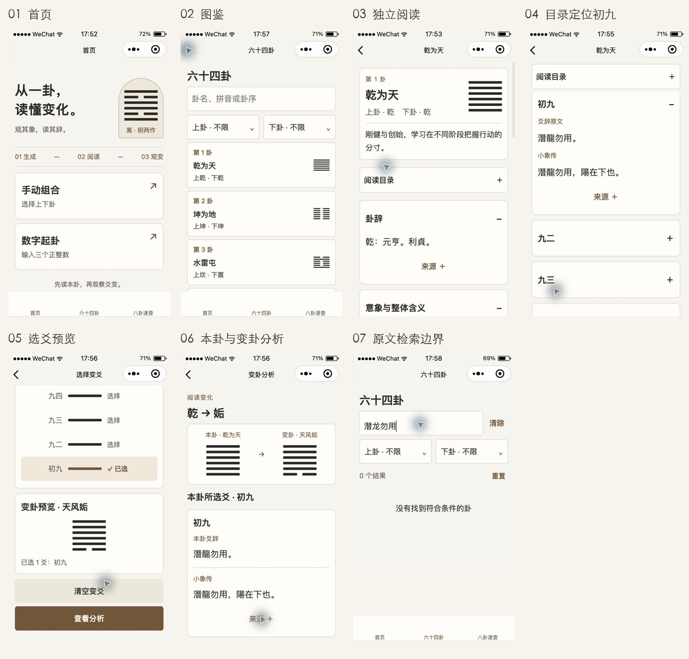

# 下一步用户体验探索

日期：2026-10-23。状态：候选方案，尚未立项或实现，不改变[现行产品与资料基线](PRD.md)。

建议先做一批“看清变化、接着查阅”的小改进，再把“按原文片段找到具体章节／爻位”作为下一轮主功能。现有独立查阅、六爻、目录、连续翻阅、系统字体与整段复制已经完成，应继续复用。

## 1. 判断依据

本轮读取当前代码、需求、开发与验收记录，并在现有微信开发者工具中走通首页→图鉴→乾卦详情→目录定位初九→选择初九→乾变姤分析→逐级返回图鉴，另输入“潜龙勿用”检查现有检索边界。环境为 Stable 2.02.2608080 模拟器、iPhone 5（320×568）、字体16，观察时间17:52～17:58。截图只证明对应状态；原始图留在 `.validation/ux-exploration-2026-10-23/`，过早取得上一页面的截图已核对并重采。此次未做用户访谈、频率统计、完整无障碍测试或新一轮真机验证，不影响之前用户确认的V2验收。

| 步骤 | 实际观察与健康度 | 含义 |
| --- | --- | --- |
| 01 首页 | 两种生成入口、底部图鉴／速查入口清晰，本轮所见布局正常 | 首页目前围绕生成展开；没有证据支持此时重做首页或一级导航 |
| 02 图鉴 | 卦名／拼音／卦序及上下卦筛选入口明确，可进入详情 | 已知卦名的查询路径完整，应保留 |
| 03 独立阅读 | 卦头、卦辞、阅读目录层次清晰 | 新能力应落在现有阅读结构上 |
| 04 目录定位 | 选择初九后展开并定位，标题没有被吸顶条遮挡 | 现有章节定位适合复用于未来检索结果跳转 |
| 05 选爻预览 | 初九有“✓ 已选”，结果变为天风姤；变卦图未标出对应变化位置 | 选择反馈正常，变化前后的对应关系仍需用户自己比较 |
| 06 分析 | 同屏显示乾、姤两幅卦形及本卦初九原文；两幅图均无变化位标记 | 结果正确呈现，但可降低逐爻比对负担；完整查阅入口缺口由页面代码确认 |
| 07 原文片段查询 | “潜龙勿用”返回0个结果；现有检索字段不包含正文 | 符合V2范围，是下一版能力机会，不是搜索故障 |

以上是界面与代码证据；功能使用频率、用户是否困惑、改善幅度均未做用户研究，不能据此声称留存或效率已提升。视觉定位和选中反馈已观察，不代表完整读屏或无障碍验收。

## 2. 候选优先级

成本是基于当前代码复用程度的相对判断，不是工期承诺。

| 顺序 | 用户任务与候选改进 | 证据性质 | 价值／成本 | 建议 |
| --- | --- | --- | --- | --- |
| A1 | 一眼看出本卦哪些爻变成了变卦：同步标出变化爻位 | 步骤05、06已观察 | 高／小 | 第一批核心 |
| A2 | 看到姤卦后继续查其六爻：在变卦资料处进入完整详情 | 页面缺少该入口已确认；需求频率待验证 | 高／小至中 | 第一批核心 |
| A3 | 数字模式返回文案符合实际能力 | 明确文案不一致 | 中／很小 | 第一批顺带修正 |
| B1 | 只记得一句原文也能找到出处，并直达对应爻位 | 步骤07及检索代码已确认能力边界；需求频率待验证 | 高／中 | 下一轮主功能 |
| C1 | 三个数字用键盘连续填写 | 代码无确认键续填逻辑；未验证真机键盘体验 | 中／小 | 小原型验证后决定 |
| C2 | 顺读六爻时减少反复展开 | 六条分别折叠是现有设计；未证实用户需要全展开 | 中／小 | 暂不增加常驻按钮 |
| C3 | 按“马、耳”等课堂类象反查八卦 | 现有资料支持基础查询；未做该任务观察 | 中／中 | 排在原文检索之后 |

### A1：变化位置直接可见

当前[选爻页](../miniprogram/pages/changes/index.wxml)只在本卦交互图中标出选中爻；[分析页](../miniprogram/pages/analysis/index.wxml)的两幅卦形没有传入变化位置。[卦形组件](../miniprogram/components/hexagram-shape/index.ts)已有选中位置能力，可沿用绘制结构。

- 在原有本卦／变卦图的同一位置同时标记变化，保持上爻到初爻绘制。以“位置”对应，不要求变化后的爻名与本卦相同。
- 沿用古铜色，并有符号／文字及可访问名称；只读结果表达“变化”，不误称为可点击“已选”。保留当前选爻列表，不只依赖颜色传达。
- 首期只标卦形变化，不增加双栏爻辞、动画、吉凶判断或新的算法。
- 验收任务：乾初九→姤时，两图底部对应位明确；多爻、零爻、全爻同样准确。使用必要交互样例验证显示映射，保留已有独立算法基准，不另建重复算法测试。

### A2：从分析接着查阅

在现有“变卦整体资料”标题旁放一个“完整查阅”文字入口，打开既有独立详情，完整六爻和目录仍只出现在详情。用户无需返回图鉴重新输入卦名；零变时入口对应当前本卦。[现有详情](../miniprogram/pages/detail/index.ts)已支持按卦编号进入。

- 单纯进入、展开、翻阅及返回，不创建或结束原分析会话；返回后保留选爻与分析位置。
- 这是一个新的详情来源，需在需求中明确其与图鉴来源的区别。首期建议从分析进入的详情仅用于查阅，不提供再次“观察变化”，避免在原分析之上开启嵌套观察；图鉴正常入口维持现有观变行为。
- 不从已有图鉴上下文借用结果列表；该入口从当前卦开始，按全部64卦阅读，返回仍回原分析。返回图鉴会离开原路径，应保持明确的次级入口。
- 验收任务：乾初九→姤→完整查阅姤九五→返回分析，仍为原乾初九结果；数字模式固定爻、零变、原会话被其他新流程替代时分别按明确规则处理。

该项需要补充PRD入口／会话契约，不能只添加一个跳转按钮就视为完成。

### A3：修正数字模式返回文案

[分析页](../miniprogram/pages/analysis/index.wxml)固定写“返回调整变爻”，而[数字模式](../miniprogram/pages/changes/index.ts)的唯一固定爻不可改选。建议数字模式改为“返回查看变爻”，手动与图鉴保持“返回调整变爻”。不改变返回层级、固定爻规则或取余计算。

## 3. 下一轮主功能：原文片段检索

目标场景：用户记得“潜龙勿用”，无需先知道它属于乾卦初九，即可查到原文、小象和出处。该功能是V2明确排除项的下一版扩展，需先纳入新需求，不能追记成V2欠项。

建议的最小范围：

1. 在现有图鉴检索区域提供“找卦／查原文”两个清晰模式，默认仍为找卦；不增加一级导航或另做一个阅读页面。
2. 检索现有964块经传、爻辞、小象及乾坤特殊原文。首期不查来源长说明、白话、审核档案，也不增加语义问答、模糊联想或联网内容。
3. 匹配时处理空白、标点及明确的简繁对应，显示与复制仍保留资料原文。以“潜龙勿用／潛龍勿用”为关键体验样例；不因匹配而把正文改为简体，不把所有异文自动视为相同。
4. 结果按卦分组，组内显示章节／实际爻名和短原文片段。同一爻辞与小象分别命中时保留标签，避免用户看到一串无法区分的重复结果；首期不必做复杂逐字高亮。
5. 点击某个命中，进入对应卦、展开对应章节并定位。需为外部章节入口补充必要校验；现有`reading.reveal`可复用，但当前编号路由还不支持直接传入章节。
6. 上下卦仍与关键词取交集。进入前固定命中卦ID快照；连续翻阅按命中卦顺序进行，不把一卦的多个片段当成多卦。仅首次点入定位所选片段，上一／下一结果沿用当前换卦默认状态；返回恢复模式、输入、筛选与列表位置。
7. 无匹配时保留关键词和筛选，让用户可清除或调整；单字、多命中、同句跨卦、特殊条文及小象命中均须定义展示方式。实现前用实际语料比较结果长度，不承诺尚未测量的响应时间。

先用少量任务评审原型：已知卦名定位、简体句子查繁体原文、同爻多处命中、筛选后无结果、进入后返回。观察用户能否自己识别正确出处及是否需要重输，不把固定点击数或性能计时设为新的发布门槛。

## 4. 暂缓的方向及原因

- **数字键盘续填**：前两项“下一项”，第三项“完成”收起键盘，生成仍由明确按钮触发；保留现有顺序、数字字符串与逐位取余。先看真机键盘支持，不能把缺少确认键逻辑称为现有输入失效。
- **六爻全部展开**：只在顺读任务反复出现时考虑一个局部操作；要先比较额外按钮与长页面的代价，不增加全局阅读模式或跨次偏好。
- **组合目标槽直接选择**：当前已有拖拽和点击菜单两条路径。只有原型证明更容易识别目标槽，才替换点击菜单，避免叠加第三套选择方式。
- **收藏／最近阅读／跨次续读**：可能有学习价值，但缺少使用频率证据，且会改变仅内存保存约定。即使后续采用，也应先做最小本地书签，并定义清除与恢复，不同时扩展账号、历史、笔记和云同步。
- **首页重做、主题、打卡、推荐、AI解读**：本轮没有支持它们优先于查阅任务的证据，且容易增加入口和正文干扰。保留当前简洁风格与学习定位。

## 5. 研究依据与交付边界

“降低记忆负担、让用户凭现有线索找到下一步”参考[NN/g 关于识别与回忆的解释](https://www.nngroup.com/articles/recognition-and-recall/)。这是设计判断的依据，不代表已研究过本项目用户。数字输入继续保留明确的字段错误文字，参考[W3C 错误识别说明](https://www.w3.org/WAI/WCAG22/Understanding/error-identification)；这些资料也不能代替微信真机与读屏验证。

实施顺序与立项状态集中维护在本文：A批先明确只读变化标识及分析来源详情的会话规则；B批先确认简繁匹配、分组去重、筛选与连续翻阅语义，并用真实查询任务评审后更新需求；C类候选暂缓，历史／收藏／跨次续读仍未纳入范围。程序版本在范围确定后再定。

2026-10-23此次探索仅产出建议与证据，没有修改程序功能、内容源、审核状态或版本，也未重新编译、运行算法或内容发布检查、上传。数字返回文案来自静态代码，键盘续填与全文检索尚未实现或验证；当时本地链接／锚点和 `git diff --check` 通过。
